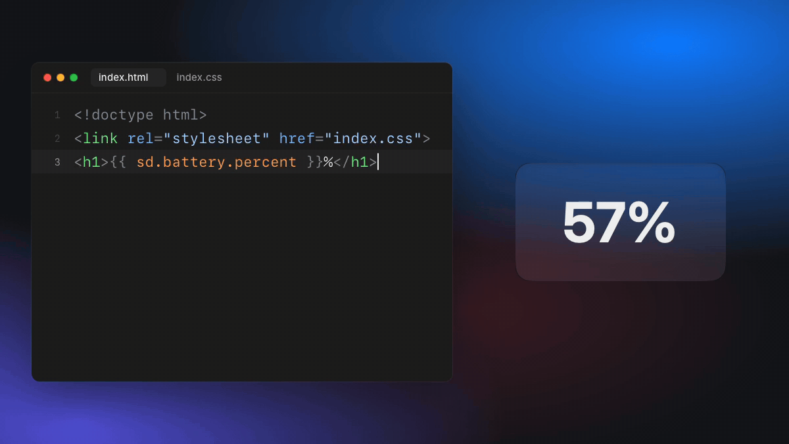

# stackd

stackd turns folders of HTML and CSS into live pieces of your Mac's desktop. You get a status bar, a hotkey launcher or a window tiler that you write like a web page, and it updates the moment you save.

<p align="center"></p>

## Install

You need a Mac with Apple silicon, macOS 13 or later, and the Xcode command-line tools (`xcode-select --install`).

```
git clone https://github.com/sryo/stackd ~/Documents/stackd
cd ~/Documents/stackd
scripts/package-app.sh
STACKD_BIN=/Applications/stackd.app/Contents/MacOS/stackd scripts/daemonctl.sh install
sudo mkdir -p /usr/local/bin && sudo ln -sf /Applications/stackd.app/Contents/MacOS/stackd /usr/local/bin/stackd
```

That installs `stackd.app`, starts it now and at every login, and puts the `stackd` command on your PATH. When it asks for Accessibility, turn it on in System Settings → Privacy & Security → Accessibility.

## Use

```
stackd new hello
```

A small panel showing your battery appears in the top-right corner. Open `~/stackd/stacks/hello/index.html`, change it, save, and the panel changes. Anything in `{{ sd.battery.percent }}` updates itself.

`stackd help` lists every command. [Using stackd](docs/using-stackd.md) covers writing stacks and everything `sd.*` can read and do, `examples/` has working stacks to copy, and [stackd-stacks](https://github.com/sryo/stackd-stacks) is a full daily setup.
