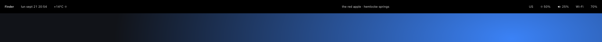
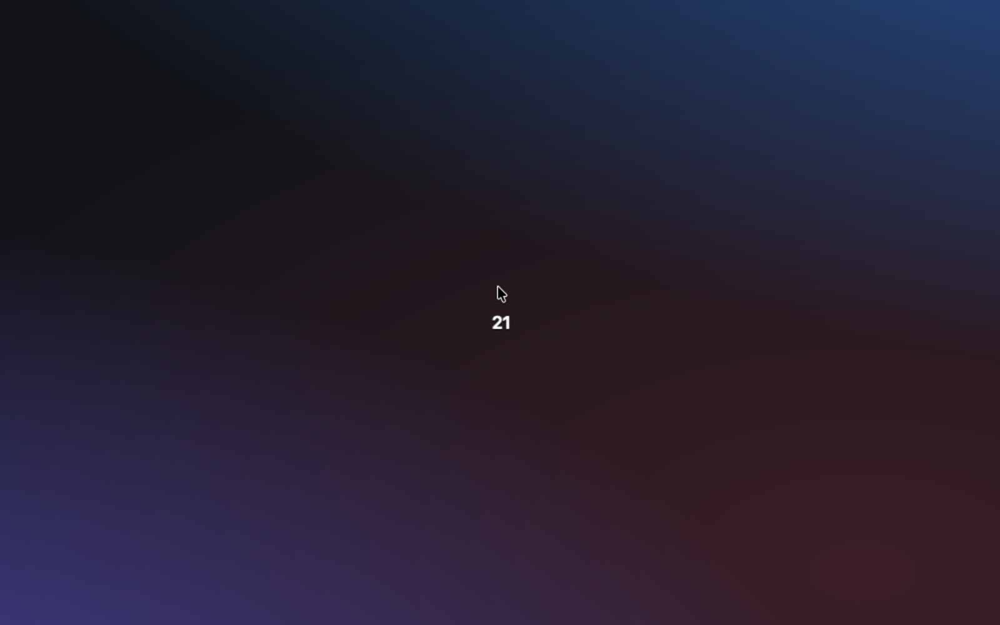

# stackd

stackd turns folders of HTML and CSS into live pieces of your Mac's desktop. You get a status bar, a hotkey launcher or a window tiler that you write like a web page, and it updates the moment you save.

<p align="center"></p>

Drop a folder into `~/stackd/stacks/` and it shows up on your desktop: a status strip across the top, a launcher you summon with a hotkey, a script that runs when you close a window. That folder is a *stack*: a `stack.json`, an `index.html` and an `index.css`. Your page reads what your Mac is doing, and acts on it, through a small JavaScript API called `sd`.

> See **[BELIEFS.md](./BELIEFS.md)** for what stackd believes.

```
~/stackd/stacks/battery/
├── stack.json         { "anchor": { "edge": "top-right", "inset": [16, 16] },
│                        "size":   { "w": 140, "h": 64 } }
├── index.html         <div id="pct">{{ sd.battery.percent }}%</div>
└── index.css
```

<p align="center"></p>

<p align="center"><br><sub><code>bar</code> — the menubar, replaced · <code>timetrail</code> — the hour, orbiting your cursor</sub></p>

These and the rest of a daily-driver config live in [stackd-stacks](https://github.com/sryo/stackd-stacks).

## Install

You need a Mac with Apple silicon, macOS 13 or later, and the Xcode command-line tools (`xcode-select --install`).

```
git clone https://github.com/sryo/stackd ~/Documents/stackd
cd ~/Documents/stackd
scripts/package-app.sh
STACKD_BIN=/Applications/stackd.app/Contents/MacOS/stackd scripts/daemonctl.sh install
sudo mkdir -p /usr/local/bin && sudo ln -sf /Applications/stackd.app/Contents/MacOS/stackd /usr/local/bin/stackd
```

That puts `stackd.app` in Applications, starts it now and at every login, and puts the `stackd` command on your PATH.

The first time it runs, stackd asks for **Accessibility** access, which it needs for hotkeys and for reading and moving windows. Turn it on in System Settings → Privacy & Security → Accessibility. Your stacks go in `~/stackd/stacks/<name>/`; stackd makes the folder for you.

## Use

### Quick start

```
stackd new hello
```

This makes `~/stackd/stacks/hello/`: three files, and a see-through panel in the top-right corner showing your battery percentage and theme. It appears on its own, with no build step. Open `index.html`, change it, save, and watch the panel change.

```html
<!doctype html><meta charset="utf-8">
<div>{{ sd.battery.percent }}%</div>
```

That's a whole stack. Anything in `{{ … }}`, in text or in an attribute, updates itself whenever the value changes.

### The manifest

`stack.json` says where the panel sits and what it can touch:

<!-- include: examples/cursor/stack.json -->
```json
{
  "id": "cursor",
  "name": "Cursor",
  "anchor": { "edge": "top-right", "inset": [96, 16] },
  "size": { "w": 140, "h": 48 },
  "material": "glass",
  "cornerRadius": 24,
  "padding": 0,
  "permissions": ["mouse"],
  "handles": ["user.beep"]
}
```

A panel can sit at any corner or side (`top-right`, `top-left`, `top`, `bottom`, `left`, `right`, …), cover the whole screen, let clicks pass through it, or stay hidden until a hotkey calls it up. Things your stack only reads are worked out from the page, so you rarely list them. Things that change your Mac, like adding a menu bar item, you list under `permissions`. The [manifest reference](docs/reference/manifest.md) covers every field.

### Templates: `{{ }}`, `sd-each` and `sd-if`

To show a value, write it in the HTML. No `<script>`, no import, no callback:

```html
<div>{{ sd.mouse.x }}, {{ sd.mouse.y }}</div>
```

`sd-each="<list>"` repeats an element once per item, with `item` and `index` available inside:

```html
<ul>
  <li sd-each="sd.usb">{{ item.productName }} ({{ item.vendorName }})</li>
</ul>
```

`sd-if="<expr>"` shows an element only when the expression is true. A missing value shows as nothing instead of an error.

Write values by their full name (`{{ sd.battery.percent }}`), and keep `sd-each` one level deep.

### Scripts: when you need more

Use a `<script>` for anything that waits, reacts to clicks, keeps state, or reshapes lists:

```html
<div id="t"></div>
<script type="module">
  import { sd } from "sd://runtime/api.js";
  sd.bind(t, sd.mouse, m => m ? `${m.x}, ${m.y}` : "…");
</script>
```

`sd.bind(target, signal, fmt?)` puts a value into text, HTML, an attribute, a CSS variable or a class. For anything else, subscribe: `sd.battery.subscribe(b => …)`. Templates and scripts work together in the same stack.

### The `stackd` command

```
stackd list                               list running stacks
stackd list --disabled                    list stacks you've set aside
stackd reload                             reload every stack from disk
stackd disable <id>                       stop a stack and set it aside in ~/stackd/disabled/
stackd enable <id>                        bring a set-aside stack back and start it
stackd toggle <id>                        stop or start a stack until the next reload
stackd set <id|/regex/> --css <prop>=<value>
                                          change a CSS variable on one or many stacks
stackd bang <name> [KEY=VAL ...]          send a message to stacks that listen for it
stackd new <name> [--template <hello|menubar|hud>]
                                          make a new stack
stackd doctor                             check every stack for mistakes
stackd help                               show this list
```

`<id>` matches one stack by name; `/pattern/` matches every stack whose name fits the pattern. Settings in `~/stackd/defaults.json` apply to every stack, which is handy for a shared corner, material or permission.

`new`, `doctor` and `help` work any time. The rest need stackd running, which it is after installing. You can call `stackd` from shell scripts, skhd or Karabiner.

`stackd doctor` catches missing fields and misspelled permissions in your stacks. It also lists the trackpad gestures macOS already uses, so a gesture stack can avoid them, and warns when your macOS is missing something stackd relies on.

## What stacks can read and do (`sd.*`)

All of this works inside `{{ }}` and in scripts after `import { sd } from "sd://runtime/api.js"`. *Signals* update on their own; *actions* do one thing when you call them. The [API reference](docs/reference/api.md) lists every method.

### Hardware

| API | What it gives you |
|---|---|
| `sd.battery` | percent, charging, cycles, health, current, voltage, time left |
| `sd.sensors` | chip temperatures, power rails, fan speed |
| `sd.host.info()` / `sd.host.load` | name, OS, chip and memory; live CPU, GPU, memory and idle time |
| `sd.caffeinate` | `{ sleeping, locked }` — whether the Mac is asleep or the screen is locked |
| `sd.displayLink` | a tick on every screen refresh |
| `sd.touchdevice` | each finger on the trackpad, frame by frame |
| `sd.bluetooth.paired()` | paired devices and whether they're connected |
| `sd.usb` | plugged-in USB devices, updated as you plug and unplug |
| `sd.disks.list()` | mounted drives |
| `sd.location` | where you are `{ lat, lon, accuracy, … }` (asks for Location) |

### Display & windows

| API | What it gives you |
|---|---|
| `sd.display.all` / `sd.display.setBrightness` / `sd.display.snapshot()` | each display; brightness; a screenshot |
| `sd.appearance` | dark or light, and the accent color |
| `sd.windows.focused` / `sd.windows.all` | the focused window; every window on screen |
| `sd.windows.setFrame / minimize / fullscreen / raise / focus / close / cornerRadius / snapshot / batch` | move, resize and manage any window |
| `sd.spaces.all` / `sd.spaces.windowSpaces(id)` / `sd.spaces.minimizedWindows(spaceID)` | your Spaces and which windows are on each |
| `sd.overlay.attach(windowId, draw)` | draw on top of another app's window, like a border around the focused one |
| `sd.desktop.hideIcons / showIcons` | hide or show desktop icons (your setting comes back afterwards) |
| `sd.menubar.suppress / restore` | hide or bring back the system menu bar |
| `sd.menubar.addItem(spec)` | add your own menu bar item |
| `sd.menu.popup(items)` | a native menu at the pointer |

### Input

| API | What it gives you |
|---|---|
| `sd.mouse` | where the pointer is |
| `sd.cursor.setPosition({x,y}) / position()` | move or read the pointer |
| `sd.input.layout` | the active keyboard layout |
| `sd.events.type / key / scroll / click` | type, press keys, scroll and click for you |
| `sd.hotkey.bind(spec, fn, opts)` / `sd.hotkey.mode.*` | hotkeys, and modes with their own set of keys |

### Apps & UI

| API | What it gives you |
|---|---|
| `sd.app.frontmost` | the app in front |
| `sd.apps.running` / `sd.apps.changed` | every running app; apps as they open and quit |
| `sd.apps.launch / focus / kill / hide` | control an app by its bundle ID |
| `sd.ax.focused()` + `sd.ax.*` | read and press buttons, fields and menus in other apps |
| `sd.icons.app(bundleId) / file(path)` | app and file icons as images |

### Network

| API | What it gives you |
|---|---|
| `sd.net.wifi` | network name and signal (the name asks for Location) |
| `sd.net.lan` | your local address and computer name |
| `sd.net.path` | `{ status, interfaces, isConstrained, isExpensive }` — whether you're online and how |
| `sd.httpserver.serve({port, routes, …})` | a small web server, on this Mac or your local network |

### Audio, media, output

| API | What it gives you |
|---|---|
| `sd.audio.output` / `sd.audio.setVolume / setMuted` | output volume and device |
| `sd.media.nowPlaying` / `sd.media.command(name)` | what's playing in Spotify, Music, Podcasts or a browser, and play/pause/skip |
| `sd.speech.speak / stop / voices()` | read text aloud |
| `sd.speech.listen(opts)` | turn speech into text (asks for Microphone and Speech Recognition) |
| `sd.sound.system / file / beep` | play a short sound |
| `sd.haptic.perform(pattern?) / actuate(id, device?)` | a tap on the Force Touch trackpad |
| `sd.notify.show(spec)` | a notification banner |

### Files, processes, saved data

| API | What it gives you |
|---|---|
| `sd.fs.read / stat / list / write / mkdir / delete / move / watch` | read, write and watch files |
| `sd.proc.exec(cmd, args, opts)` | run a command |
| `sd.applescript.run(source, opts)` | run AppleScript or JavaScript for Automation |
| `sd.shortcuts.run(name, opts)` | run a Shortcut by name |
| `sd.defaults.read(bundleId, key)` | read any app's settings |
| `sd.settings.get / set / delete / all` | save your stack's own settings |
| `sd.sqlite.open(path)` → `.exec / query / close` | a SQLite database, with full-text search |
| `sd.pasteboard.changed` / `sd.pasteboard.get / set` | the clipboard, read and write |

### Intelligence

| API | What it gives you |
|---|---|
| `sd.vision.ocr / faces / featurePrint / subjectMask / bodyPose` | text, faces, subjects and poses in images |
| `sd.nlp.language / tokens / lemmas / similarity` | language, words and similarity in text |
| `sd.spotlight.find({predicate, …})` | Spotlight searches |
| `sd.calendar.events({from, to}) / list() / reminders() / createEvent(opts)` | your calendar and reminders; add events (asks for Calendar) |
| `sd.camera` / `sd.camera.frame(opts)` / `sd.camera.stream(opts)` | your cameras; a still or a live feed (asks for Camera) |

### Stack control

| API | What it gives you |
|---|---|
| `sd.bang(name, detail)` | send a message to every stack that listens for it |
| `sd.broadcasts.subscribe(name, fn)` | system-wide notifications from other apps |
| `sd.window.invoke() / dismiss()` | show or hide a stack that a hotkey calls up |

Window events (`sd.window.created / destroyed / focused / titleChanged / moved / resized / resizing / animating / minimized / deminimized / reordered / focusedByMouse`) and drives being mounted or unmounted (`sd.disk.mounted / unmounted`) arrive as bangs. List the ones you want in `stack.json`:

```json
{ "handles": ["sd.window.destroyed", "sd.disk.mounted"] }
```

Hotkeys and trackpad or keyboard event listeners are listed in the manifest too. `examples/` has working patterns.

## Examples

`examples/` holds <!-- count: examples/**/stack.json -->47<!-- /count --> working stacks covering most of the list above. A few places to start:

- **`hello`** — what `stackd new` makes: a three-file panel.
- **`menubar-item`** — your own menu bar item with submenus.
- **`invocable-palette`** — a launcher you call up with a hotkey, with fuzzy app search.
- **`fs-watcher`** — a panel that updates as files change.
- **`bang-pair`** — two stacks talking to each other.
- **`sysinfo`** / **`sensors-test`** / **`displaylink-test`** — the harder-to-get readings.

Copy any of them into `~/stackd/stacks/` to try it.

Stacks in daily use include `bar` (a replacement menu bar), `sysinfo`, `notunes`, `apptimeout`, `palette`, `timetrail`, `undoclose`, `autodmg`, `sideswipe`, `muse`, `cloudpad`, `digup`, `edgehopper`, `framecorners`, `tttaps` and `windowscape`.

## Known gaps

- AirPods and other Bluetooth battery levels aren't available yet.
- Stacks can't yet be told when something changes inside another app's window or controls (`sd.ax.observe`).

What stackd won't do: it never phones home, has no analytics, no auto-updater, no central stack store, and no closed stack format — a stack is a folder you can read and edit. It never takes focus away from the app you're using. Permission prompts (Accessibility, Calendar, Location, Camera) come from macOS itself; stackd doesn't stand in for them.

How stackd works inside — its history, the macOS frameworks behind each API, where files live — is in [docs/internals.md](docs/internals.md).
